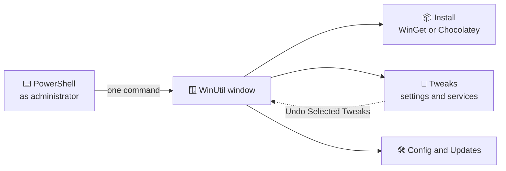

<h1 align="center">
  <br>
  
  <br>
  Windows Nireekshana
  <br>
</h1>

<h4 align="center">A copy of Chris Titus Tech's WinUtil: install apps, remove clutter and fix common Windows problems from one window.</h4>

<p align="center">
  <a href="https://github.com/ChrisTitusTech/winutil/releases/latest"></a>
  
  <a href="LICENSE"></a>
</p>

<p align="center">
  <a href="#-what-it-does">What it does</a> •
  <a href="#-get-started">Get started</a> •
  <a href="#-how-it-works">How it works</a> •
  <a href="#-faq-and-troubleshooting">FAQ</a> •
  <a href="#%EF%B8%8F-for-developers">For developers</a>
</p>

<p align="center">
  
</p>

WinUtil is a free tool for anyone setting up or tidying a Windows 11 PC. It gathers app installs,
privacy and speed tweaks, repair tools and update settings in one window. This repository is a
copy (fork) of [ChrisTitusTech/winutil](https://github.com/ChrisTitusTech/winutil) with **no
changes yet**. One honest limit: many tweaks change Windows deeply, so make a restore point first.

> [!NOTE]
> This copy has no releases of its own. The command below runs the official WinUtil from Chris
> Titus Tech, the same code as this repository.

## ✨ What it does

- 📦 **Install apps in bulk** – tick apps from a list of about 240 and install or upgrade them all
  at once, through WinGet or Chocolatey (Windows package managers).
- 🧹 **Remove clutter** – switch off telemetry, ads in Start, widgets and other extras, or remove
  built-in apps you don't use.
- 🎚️ **Presets** – **Standard**, **Minimal** or **Advanced** tick a sensible set of tweaks for you.
- ↩️ **Undo** – **Undo Selected Tweaks** puts most tweaks back as they were.
- 🛠️ **Fixes and features** – turn on Windows features such as Hyper-V, WSL or Sandbox, and run
  repairs such as a network reset or a system corruption scan, on the **Config** tab.
- 🔄 **Calmer updates** – pick **Recommended** (security updates on time, big upgrades a year
  later), the Windows default, or turn updates off.
- 💿 **Your own Windows 11 installer** – **Win11 Creator** makes a trimmed ISO file or USB stick
  from the official Windows download.
- 🌗 **Light and dark themes**, and a search box to find any setting.

## 🚀 Get started

### Step 1 – Check your PC

| You need | Notes |
| --- | --- |
| Windows 11 | Windows 10 is no longer supported by WinUtil |
| Administrator rights | WinUtil changes system settings |
| An internet connection | To start WinUtil and to download apps |

### Step 2 – Open PowerShell as administrator

1. Right-click the **Start** button.
2. Choose **Terminal (Admin)**. If Windows asks *"Do you want to allow this app to make changes?"*,
   click **Yes**.

Or press the **Windows** key, type `PowerShell`, then press **Ctrl + Shift + Enter**.

### Step 3 – Start WinUtil

Paste this line into the window and press **Enter**:

```powershell
irm https://christitus.com/win | iex
```

`irm` downloads the script and `iex` runs it. The first start takes a few moments.

### Step 4 – First steps

1. Open **Tweaks** and tick **Restore Point - Create** first, so you have a way back.
2. Click **Standard** to tick the recommended tweaks. Hover over any item to read what it does.
3. Click **Run Tweaks** and wait for it to finish.
4. To install apps, open **Install**, tick the apps you want, then click **Install/Upgrade
   Applications**.
5. Close WinUtil when you are done. Changes stay after it closes.

<details>
<summary><b>Run a preset without clicking</b></summary>

```powershell
& ([ScriptBlock]::Create((irm https://christitus.com/win))) -Preset Standard
```

| Preset | What it ticks |
| --- | --- |
| `Standard` | Balanced defaults for most people |
| `Minimal` | Only changes that suit everyone |
| `Advanced` | Deep tweaks for experienced users |

Every preset's exact list is in [config/preset.json](config/preset.json).

</details>

## 🧭 How it works



- **WinUtil is one PowerShell script.** Nothing is installed; it runs while the window is open.
- **App installs** go through WinGet or Chocolatey, which download each app from its own source.
- **Tweaks** change Windows settings, services and scheduled tasks. Most can be undone from the
  same tab.
- **The lists** of apps, tweaks and features live in plain JSON files in [config/](config/).

> [!IMPORTANT]
> Some tweaks, such as removing the built-in browser or cloud storage app, are hard to undo. Tick **Restore Point
> \- Create** before you run them, and read the tooltip first.

## ❓ FAQ and troubleshooting

<details>
<summary><b>Is it safe?</b></summary>

It is open source and widely used. Run it only from the official command above, make a restore
point first, and apply only tweaks you understand.
</details>

<details>
<summary><b>A tweak broke something</b></summary>

Open WinUtil again, go to **Tweaks**, tick the same tweak and click **Undo Selected Tweaks**. If
that does not help, use System Restore to go back to your restore point.
</details>

<details>
<summary><b>I get an "Execution Policy" error</b></summary>

Run this in the same window, then start WinUtil again. It only lasts until you close that window:

```powershell
Set-ExecutionPolicy Unrestricted -Scope Process -Force
```
</details>

<details>
<summary><b>How do I uninstall WinUtil?</b></summary>

There is nothing to uninstall. Closing the window ends it. Apps it installed stay installed.
</details>

<details>
<summary><b>Where is the full documentation?</b></summary>

On the [official documentation site](https://winutil.christitus.com/), with
[known issues](https://winutil.christitus.com/knownissues/). Its source is in [docs/](docs/).
</details>

## 🛠️ For developers

<details>
<summary>Build and test</summary>

WinUtil is built from many small files into one script, `winutil.ps1`.

```powershell
.\Compile.ps1           # builds winutil.ps1 from functions/, config/ and xaml/
.\winutil.ps1           # run the build, as administrator
Invoke-Pester -Path 'pester/*.Tests.ps1'   # tests
```

- How the project is built and laid out: [SPEC.md](SPEC.md).
- How to contribute: [CONTRIBUTING.md](.github/CONTRIBUTING.md). Upstream issues go to
  [ChrisTitusTech/winutil](https://github.com/ChrisTitusTech/winutil/issues).

</details>

## Credits

WinUtil is made by [Chris Titus Tech](https://github.com/ChrisTitusTech) and its
[contributors](https://github.com/ChrisTitusTech/winutil/graphs/contributors). To support the
project, see [its sponsors page](https://github.com/sponsors/christitustech) and leave a ⭐ on
[the original repository](https://github.com/ChrisTitusTech/winutil).

## License

[MIT](LICENSE), copyright CT Tech Group LLC.

---

> GitHub [@sudharamachandranrajeev](https://github.com/sudharamachandranrajeev)
